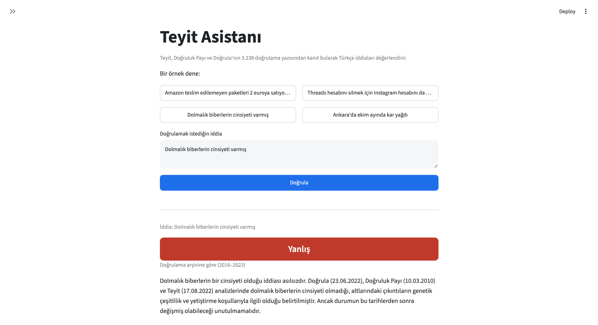

# Teyit Asistanı: Turkish Fact-Checking Assistant with RAG

A retrieval-augmented generation (RAG) system that checks Turkish claims against the archives of Turkish fact-checking organisations and gives a sourced verdict. If the archive has no matching fact-check, it searches recent fact-checks live through the Google Fact Check Tools API. When neither source covers the claim, it says so instead of guessing.

> Workintech Data Scientist & AI UpPro capstone project.



## Highlights

| | Result |
|---|---|
| Verdict accuracy (100 balanced claims, claim in archive) | **0.97** (Gemini without RAG: 0.61) |
| Macro F1 over TRUE / FALSE | **0.985** (without RAG: 0.71) |
| Opposite verdicts (true called false or vice versa) | **0** (without RAG: 11) |
| Retrieval Recall@3 / MRR | **1.00 / 0.995** |
| Claims missing from the archive handled correctly | **97%** after manual review (83% strict) |

## How it works

```
User claim
   │
   ▼
Layer 1: Archive RAG (3,238 fact-checks, 2016–2023)
   1. Retrieve the 3 most relevant articles (multilingual-e5-base + ChromaDB)
   2. Add each article's summary
   3. Gemini judges, for each article, whether it examines the SAME claim
   4. Verdict is based only on same-claim articles; a code guardrail enforces this
   │
   ├── Same claim found ──────────────► Verdict + explanation + sources
   │
   └── Not enough evidence
          │
          ▼
       Layer 2: Live search (Google Fact Check Tools API)
          1. Search with the user's sentence; if nothing is found,
             Gemini rewrites it into short keyword queries
          2. Keep only Teyit, Doğruluk Payı and Doğrula
          3. Same prompt, same-claim judgement and guardrail as Layer 1
          │
          ├── Same claim found ───────► Verdict + sources (recent fact-checks)
          └── Nothing found ──────────► "Not enough evidence"
```

Verdicts: `TRUE`, `FALSE`, `MIXED` (fact-checker's verdict is mixed or partly false) and `NOT_ENOUGH_EVIDENCE`.

## Data

**FCTR** (Cekinel et al., LREC-COLING 2024): 3,238 Turkish fact-check articles from Teyit (1,971), Doğruluk Payı (742) and Doğrula (525), published between July 2016 and July 2023. Each record has a claim, the article text, a summary, a verdict and a URL. The label distribution is highly imbalanced: 86% false, 6% true.

The dataset is licensed for research use only and is **not redistributed** in this repository. Download it from the [FCTR repository](https://github.com/firatcekinel/FCTR) and place it at `data/raw/fctr.csv`.

### Cleaning (notebook 04, `src/data_cleaning.py`)

| Problem found in EDA | Decision |
|---|---|
| Sentences glued together (`edildi.İddialara`), 13,710 occurrences | Insert the missing space |
| Headings glued to the previous sentence (`eklenmişGörseldeki`) | Split, while protecting 42 reviewed CamelCase brand and account names (WhatsApp, PolitiFact, ...) |
| "İlginizi çekebilir:" related-article links inside the text (168) | Removed; verified that the following text continues the main article |
| Escaped quotes (`\"`) in 18 texts | Normalised |
| Misspelled label `kismen yanliş` | Fixed; 8 labels mapped to TRUE / FALSE / MIXED / UNPROVEN, originals kept |
| Claims written as conclusions ("... tedavi yöntemi değil"), where the label refers to the original claim | Flagged (`is_headline_claim`, 261 records), excluded from the test set, explained to the model in the prompt |
| Texts ending without punctuation | Flagged (`possibly_truncated`), not removed |

Two silent bugs (a mistyped variable and a wrong rule order) were caught during validation and are covered by regression tests.

## Method

**Chunking.** 57% of the evidence texts exceed the embedding model's 512-token limit, so the final part of an article (usually the conclusion) would be cut off. Articles are split at sentence boundaries into chunks of at most 300 tokens with a one-sentence overlap; each summary is a separate chunk. This gives 13,242 chunks.

**Contextual chunk headers.** Each chunk is embedded together with its article's claim, so a chunk from the middle of an article still carries its topic.

**Retrieval.** `intfloat/multilingual-e5-base` embeddings (with the `query:` / `passage:` prefixes) in a persistent ChromaDB collection with cosine distance. 30 candidate chunks are retrieved and reduced to one best chunk per article.

**Generation.** Gemini returns structured output validated by a Pydantic schema. Before giving a verdict, the model states for every piece of evidence whether it examines the same claim as the user's (`is_same_claim`). Similarity is not sameness: in a 3,238-article archive, related but different claims score almost as high as the correct article (0.83 vs 0.89).

**Guardrail.** If no evidence is judged to be the same claim, the verdict is forced to `NOT_ENOUGH_EVIDENCE`, whatever the model answered.

**Live layer.** The Fact Check API only returns titles and verdicts, matches keywords rather than meaning, and includes publishers outside our scope. An adapter converts its results to the archive's evidence format so the same prompt, schema and guardrail can be reused; results are filtered to the three organisations; and full sentences that find nothing are rewritten into short keyword queries by Gemini (query rewriting).

## Evaluation (notebook 07, `results/`)

**Test set.** 100 claims (50 TRUE, 50 FALSE) sampled from records with a binary label that are not conclusion-style headlines.

**Avoiding leakage.** Because every chunk contains its claim, using the archive's claim text as the query would put the answer inside the search. Claims were therefore rewritten as user-style sentences by Gemini and checked by hand. The first prompt changed the meaning or dropped key entities in about half of the sampled rewrites (for example "no building collapsed" became "no building was damaged"); the revised prompt fixed all of them.

**Scenarios.**
- **A, claim in archive:** expected verdict = the fact-checker's label
- **B, new claim:** the claim's own article is excluded from the search; expected verdict = not enough evidence
- **No RAG:** Gemini answers from its own knowledge

**Results.**

| System | Accuracy | Macro F1 | Abstained | Opposite verdicts |
|---|---|---|---|---|
| RAG | 0.97 | 0.985 | 2% | 0 |
| No RAG | 0.61 | 0.710 | 28% | 11 |

- Precision for both TRUE and FALSE is 1.00: whenever the system said true or false, it was right.
- The three errors are cautious, not wrong: an article covering several claims at once, a rounding tolerance (the claim that the Greek minimum wage buys 1,088 eggs: the fact-checker found about 1,004 and still rated it true; the model answered MIXED in the evaluation run but TRUE when the claim was asked again, showing that this borderline case is unstable) and a time-scope mismatch (first five months vs the whole year).
- Without RAG, Gemini endorsed 4 false claims and rejected 7 true ones, without sources.
- **Scenario B:** 83% correct abstention. All 17 decisions agreed with the excluded article's label; manual review showed that 14 of them used **another organisation's fact-check of the same claim**. FCTR removed exact duplicates only, so the same claim often appears several times. Counting these as correct gives 97%.
- The guardrail was never triggered in 200 runs: the model's verdicts were always consistent with its own evidence judgements.

## Case study

*"Ankara'da ekim ayında kar yağdı"* ("It snowed in Ankara in October"). The live layer finds a Teyit fact-check from 16 October 2026 labelled **false**. The label refers to stock footage shared as Ankara; the article itself reports that it did snow in Ankara's higher districts that day. A system that copies labels would have called a true statement false. Ours answers "not enough evidence" and points the user to the article. The correct answer ("true") is missed because the API exposes only titles, not article content.

## Limitations

- The archive ends in July 2023.
- Test queries keep the key entities of each claim; vague or entity-free questions are likely harder for retrieval.
- Most recent misinformation is about videos and images; FCTR contains very few such claims, and the system works on text only.
- The live layer sees only titles and verdicts, finds only claims these organisations have already checked, and is not part of the quantitative evaluation.
- The system is built for checkable claims, not general questions ("X nedir?").
- Only verdicts were evaluated, not explanations. Explanations can misuse details from the evidence: for the Greek egg claim, the model attributed a figure the article calculated for Turkey (1,697 eggs) to Greece. The number exists in the evidence, but in a different context (a faithfulness error rather than an invented fact).
- Results come from a single evaluation run. Even with `temperature=0`, LLM outputs are not fully reproducible, and borderline cases can change between runs, so accuracy may vary by about one or two claims.

## Future work

- Exclude semantic duplicates in the "new claim" evaluation
- Hybrid search (BM25 + embeddings) with Turkish stemming, compared on Recall@k
- Access to article summaries for the live layer
- Scheduled ingestion of recent fact-checks into the archive
- Evaluate explanation faithfulness separately from verdicts, and show the retrieved passage in the app so users can verify details
- Repeat the evaluation several times and report the mean and spread of each metric

## Project structure

```
teyit-asistani/
├── app.py                  # Streamlit interface
├── src/
│   ├── config.py           # paths, model names, parameters
│   ├── data_cleaning.py    # text cleaning and label mapping
│   ├── chunking.py         # sentence-based chunking
│   ├── retrieval.py        # embeddings, ChromaDB, retrieval
│   ├── generation.py       # prompt, Gemini, guardrail, live layer
│   ├── factcheck_api.py    # Google Fact Check Tools API client
│   └── evaluation.py       # test set, metrics, cached runs
├── notebooks/              # 01 setup ... 08 live API
├── tests/                  # 27 unit and integration tests
├── results/                # evaluation metrics (CSV)
└── requirements.txt
```

## Setup

```bash
git clone https://github.com/SimgeCevik/teyit-asistani.git
cd teyit-asistani
python -m venv .venv
source .venv/bin/activate
pip install -r requirements.txt
```

Create a `.env` file:
```
GEMINI_API_KEY=your_key
FACTCHECK_API_KEY=your_key
```

Build the data and the index (place `fctr.csv` in `data/raw/` first):
1. Run `notebooks/04_data_cleaning.ipynb` → `data/processed/fctr_clean.parquet`
2. Run `notebooks/05_build_index.ipynb` → `chroma_db/`

Run the app and the tests:
```bash
streamlit run app.py
python -m pytest -v
```

## Tech stack

Python 3.12 · pandas · sentence-transformers (multilingual-e5-base) · ChromaDB · Google Gemini (google-genai, Pydantic structured output) · Google Fact Check Tools API · Streamlit · pytest

## Acknowledgements

Cekinel, R. F., Karagoz, P., & Coltekin, C. (2024). *Cross-Lingual Learning vs. Low-Resource Fine-Tuning: A Case Study with Fact-Checking in Turkish.* LREC-COLING 2024.

The fact-checking work of Teyit, Doğruluk Payı and Doğrula makes this project possible.
